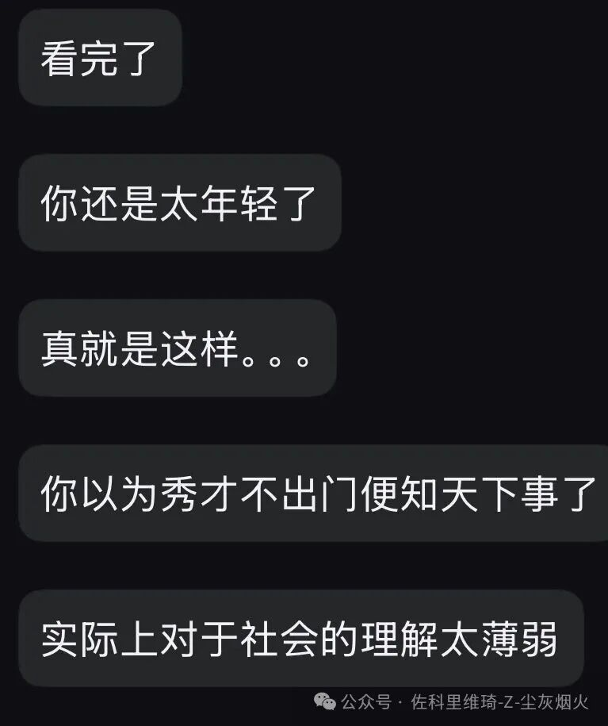
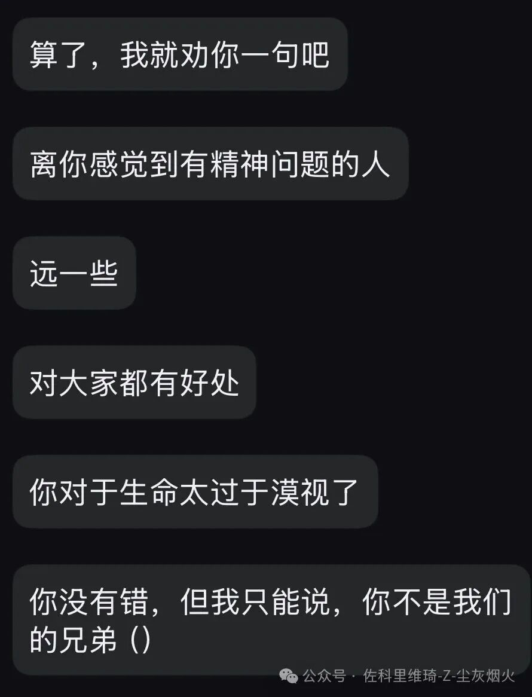
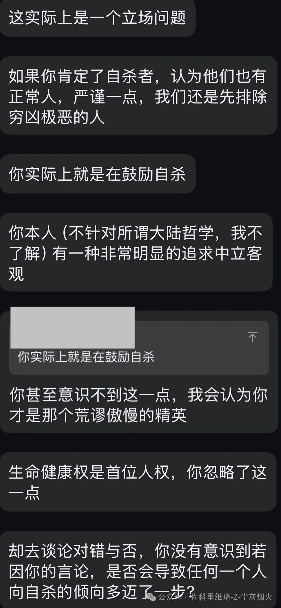
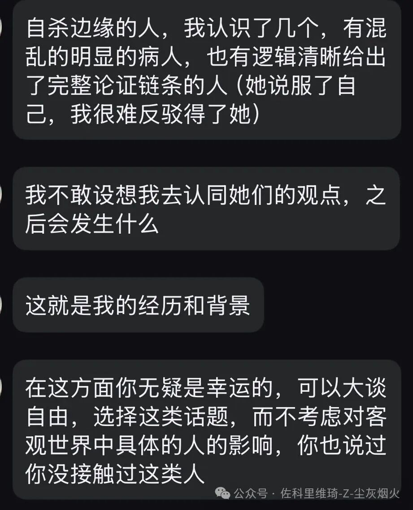

前排提醒：本文涉及到对“自杀”这一敏感话题的论述。因为在现代化和后现代化的大背景下，基于此，笔者坚持认为无论任何时候自杀是不应采取的行为。以及本文讨论的自杀群体已经被框限在一个很小的范围内。如果读者能够从本文有所收获，那自然是极好的，但是若是气愤到了读者，我也希望您能够指出不足之处。

> 【幻影忍者 前情提要：本文是在一次辩论中用于回复对方的观点，双方的观点在正文中都会有所表述。在这一版用于发表的版本，出于尊重，删掉了许多直接针对对方本人的，具有强烈的个人因素/隐私的内容，替换为了更加普适的表述，并且删掉了骂人的部分，文中的“你”或“对方”读者均可认为代指这位对方辩手，好结局的是，辩论最后以我的败诉落幕。】

活着不再是第一要务的时候，人们会做什么？我也只是最近才偶尔想一想这个问题。如果活着不再是必须的，自杀就成为了一种选择，本来不应该有这个选项，但是就这么开放了。这不是一个后现代才有的问题，但是这是一个到了后现代才和很多人息息相关的问题。

在这里，对方的观点是“自杀只是疾病得不到治疗的结果”首先，此观点有一个先假设“自杀的一定是有病的”。这是荒谬，傲慢而精英的观点。

但是另外一种观点，也是我自己认同的，自杀从来不只是个人因素，他包含了社会结构和群体因素等多重作用。这个观点诞生自刘燕舞《农民自杀研究》，刘燕舞老师的观点则可以概括为“某些群体在特定的社会结构中，自杀的风险被系统性地抬高了”。以下我会尝试说明，自杀为什么不只是个人因素。

人从来不是一座孤岛，每个人都息息相关。如果描述我理解的社会结构，就是人与人之间的关系组成的一张网，没有人能真正脱离他人。那么在一些特定的人际关系中，部分人自杀的风险被“系统性地”提高了。这一点在刘燕舞的论文中体现为农村的老人和妇女总是有更高的自杀率，简要来说，农村妇女受欺负、没地位、没尊严，只有活着体会这种可以称作苦痛的生活或自杀，在这里对于农村的妇女而言，自杀是解脱，是反抗，是挑战权威和传统的手段，而另，老年人甚至会因为“老人不能拖累家里人”这种原始农耕社会的想法就自杀。

“系统性”作为一种惯性，在这里表现为农村中妇女总是没地位和老人被认为是累赘之类的想法，这些想法形成了一种文化，一种思绪，最后促使了行动的产生。

至于我国的老年人的精神疾病，也是长期被漠视的，这倒是题外话。可是精神病在这里是结果，而不是起因。真正的起因是社会结构的病态。尽管在刘燕舞的研究中，我们最后知道了随着改革开放和人口流动，农村受到文化冲击，这些原来的封建固有糟粕已经消失很多了，而农村自杀率也已经有所缓解。

如果简单把自杀归因为病理导致，或者个人因素，一时冲动，一时兴奋。我们或许能够在个体上制止身边的人自杀，却没有办法解决作为集体行为的自杀。

“自杀是一种选择”这是一个观点的同时，却又是一个社会给出来选项。那个精神病治疗的视频（帮助精神病人自杀：为何更令我憎恶心理健康体系-哔哩哔哩https://b23.tv/BuE2v0F）我和朋友比较深入的探讨过为什么。如果我没有记错，当时的结论是【“精神病只是想法不同于主流的人”，也就是认可了福柯的“疯癫是被理性制造出来的它者，用对立维护自身的权威”这样的观点。视频提出了：“精神病真的是病吗？如果不是，我们为什么像对待病人一样对待他们？”这样的问题本视频指出：现代的精神病治疗体系的目的从来不是真正的治病，而是对精神病人的再社会化，无论病人付出何种代价，哪怕是自杀】由此看来，自杀的人并不一定有病，也有可能是我们认为他们有病；或者是我们，社会结构中的一员，参与了让他们“生病”的过程。

再社会化，很有分量的词汇。我们所有人都无法脱离这个生产体系，那么当背弃者想要回归的时候，就要付出代价。生产体系不关心个人的特点，当且仅当不影响生产。请允许我借用AI的表达：再社会化的目标，是让人重新成为对系统“可用”的人。而一个人如果在精神和身体上已经无法或不愿再被使用，系统对他的容忍度会急剧下降。正是这种“无用者”的位置，让自杀变得像一个被默认的出口。

那么再加上我之前的表述，我相信读者也可以理解我想要表达的：只要这样的社会结构还存在，自杀就是一种被提供的选择。

再以下是我自己的申辩

在“自杀是一种选择”这个问题上，似乎一开始我就把他当成一种事实在表述并且表达承认，也就是在这里，我的观点是“＂自杀是一种选择＂已经成为了已然发生的事实”而不是什么要把他做成一个现实。上文中我已经说明为何“自杀”是且成为了一种选择，无论我们传统的道德观念允许不允许，而关于我究竟如何看待自杀，我也加以表述了。

我认为一个足够理想的、进步的社会应该一开始就不存在精神病产生的空间。显然这个太容易字面意理解了。以下我会尝试做出阐释。我的不存在，在一个角度上可以借用鲁迅的话“他们应该有新的生活，为我们从未生活过的。”一个一开始就不会放大抑郁，焦虑等负面情绪的社会，而是可以帮助人消解这些情绪的社会。在另外一个角度上，正常的人不再把广泛的精神病人作为一个对立的群体，不作为一个疾病的群体，我们要去消解福柯“疯癫是被理性制造出来的它者，用对立维护自身的权威”这种观点之所以能产生的原因。这才是我追求的包容。而这里所言说的正常人，如果允许我傲慢一点，也就是马克思说的“解放的人”，而不是如今现代/后现代被重新定义/异化的“正常人”这个概念。在后者的概念下，我们都不是正常人，因为后者，借用别人说的，是为了服务体系和既得利益者被制造出来的概念。

生产体系，一个社会为了维持自身存在而建造的庞然的机器。他包含太多我一知半解或不理解的东西。

至于为什么感觉，我，笔者，把这些“罪恶”当作无可奈何，这是我个人的局限。我真的有能力去改变一个病态的社会结构？我当然不会相信。况且这个病态的社会结构仅仅是我认为他病态，而不是生产体系认为他病态。而想要一个认为这个社会结构不好的生产体系，我们大概需要一个更好的社会，一个好到当下我们都无法想象的社会。

“活着大于一切”这样的理念，对于自己当然是好的，可是我们在加于他人之身时，对于仍然在精神疾病折磨之下的人们，有时候不是理解，而是宣判。复杂的，社会性的痛苦被如此的简化了。

“后现代”是一个文化现象，是一个当下仍然正在进行的文化运动。在这里，活着成为了需要被论证被体验被赋予生命的议题，而不再是你信念中的一个先验的议题。所以我给了你一个古典的标签，你相信活着是先于这一切的意义存在。可是活着被拉下泥潭来是已经发生的事实，对我而言，对部分人而言，对越来越多人而言。被问及活着为了啥，会回答为了钱，为了XX，为了艺术文化，为了不知道。人们越来越多的问这个问题，越来越想要找到这个问题的答案，以至于匆忙填上一个答案。能够像你一样认为活着就活着，活着是先在的，这样回答的人，或许不多见吧。这样的情况究竟是好是坏，我做不了评判，因为我也是在追寻意义的一员，当我发觉的时候，我已经在后现代的浪潮里了，只缘身在此山中。

我对后现代的了解全部来自于我个人可以说狭隘的生活实践，以及费瑟斯通老先生的《消费文化与后现代主义》这一本书给了我很多启示。

费瑟斯通老先生的理念，是即使后现代无法给出答案，我们仍要尽力去研究这些问题。希望我这一个门外汉也能够追随这样的理念。也谢谢你愿意读到这里。

另下附对方的回复的【节选】，删掉了可能涉及个人隐私的部分，也希望为读者提供另一个角度的观点。

{: .post-image-sm }

{: .post-image-sm }

{: .post-image-sm }

{: .post-image-sm }

再附：至于鼓励自杀一事，可参见申辩之前的，借由AI表述的内容：不仅仅是“自杀是一种选择”变成了已然发生的事实，一个“鼓励”自杀的社会结构也已然形成。在这两个“事实”之下。或许我们不去承认，去否定，并坚信不应如此并付诸于行动，也是一种反抗，是积极而值得赞许的。当然，重点在于付诸于行动，所以这一点大概是我输了。但是他已经发生了
